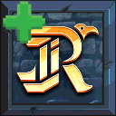

<p align="center">
  
</p>

<h1 align="center">Ravengard Plus</h1>

<p align="center">
  Client-side item utilities for Hypixel Ravengard on Minecraft 26.1, 26.1.1, 26.1.2, 26.2, and 26.3, with Fabric and NeoForge builds.
</p>

<p align="center">
  <a href="https://www.curseforge.com/minecraft/mc-mods/ravengardplus"></a>
  <a href="https://modrinth.com/mod/ravengardplus"></a>
  <a href="https://github.com/Senior-S/Ravengard-Plus/releases"></a>
</p>

Ravengard Plus adds clear inventory markers for item value and equipment upgrades. Every feature is visual and runs on the client.

## Features

### Crown values

While an inventory or container is open, each item with a Crown value shows the lore glyph and number in its upper-left corner, with separate glyph and number colors and an option to hide the glyph.

The player inventory screen shows the combined Crown value of carried and equipped items below the ability slots. Stack values are multiplied by item count, and container contents are excluded.

### Container replacement hints

When every usable inventory slot is occupied, opening a container compares its Crown-valued items with the cheapest replaceable item you carry. A bright tint marks the inventory item to replace whenever the container offers something more valuable. Container items worth the same or less receive a light-gray tint. Accessory slots and the final hotbar slot remain reserved and do not count toward inventory fullness.

Health items like bandages are left out by default. To keep any other item from being highlighted, hover over it and press `H`. Its tooltip shows whether it's ignored, and pressing `H` again undoes it.

### Armor upgrades

An arrow marks the best armor upgrade for each equipment slot. Armor models the current class cannot equip get skipped. The indicator has its own toggle and color setting.

### Accessory upgrades

Necklaces, earrings, belts, and rings are compared with the matching accessory. One arrow marks the strongest candidate that preserves every current buff and improves at least one value. Extra positive buffs count as an improvement. Accessory indicators have a separate toggle and color.

### Ability cooldowns

When using an ability get a timer with configurable color and text scale, with scale limited to 50-150%. The expiry sound is enabled by default, can use any registered Minecraft sound event, and can be previewed from the configuration screen.

### Entity full bright

Every entity renders at maximum brightness by default while world lighting stays unchanged. This includes hostile and passive mobs, players, dropped items, projectiles, and display entities.

## Configuration

Press `O` in game to open the configuration screen. You can rebind this key under Minecraft's Controls settings.

The menu is powered by [YetAnotherConfigLib](https://modrinth.com/mod/yacl) and covers feature toggles, colors, and indicator styles.

## Translations

Locale files live in the root `translations` directory and are included in every Fabric and NeoForge jar. Add a locale such as `es_es.json` or `ru_ru.json` there, using `en_us.json` as the complete key reference.

## Installation

### Fabric

1. Install [Fabric](https://fabricmc.net/use/installer/) for your Minecraft version.
2. Add [Fabric API](https://modrinth.com/mod/fabric-api) and [YetAnotherConfigLib](https://modrinth.com/mod/yacl) to the `mods` folder.
3. Add the matching Ravengard Plus jar to the same folder.

| Minecraft | Ravengard Plus jar | Java | YACL |
| --- | --- | --- | --- |
| 26.1-26.1.2 | `+mc26.1-26.1.2` | 25 or newer | 3.9.5 or newer for Minecraft 26.1 |
| 26.2 | `+mc26.2` | 25 or newer | 3.9.5 or newer for Minecraft 26.2 |
| 26.3 | `+mc26.3` | 25 or newer | 3.9.5 or newer for Minecraft 26.3 |

All versions require Fabric Loader 0.19.3 or newer.

### NeoForge

1. Install NeoForge for your Minecraft version.
2. Add the matching NeoForge build of YetAnotherConfigLib to the `mods` folder.
3. Add the matching Ravengard Plus jar to the same folder.

| Minecraft | Ravengard Plus jar | Java | YACL |
| --- | --- | --- | --- |
| 26.1-26.1.2 | `+mc26.1-26.1.2-neoforge` | 25 or newer | 3.9.6 or newer for Minecraft 26.1 |
| 26.2 | `+mc26.2-neoforge` | 25 or newer | 3.9.5 or newer for Minecraft 26.2 |
| 26.3 | `+mc26.3-neoforge` | 25 or newer | 3.9.7 or newer for Minecraft 26.3 |

The NeoForge Mods screen and the `O` key both open the YACL configuration screen.

## Building from source

Shared Java code lives in `common/src/main/java`. The `common/src/26.1/java` and `common/src/26.2/java` directories contain the screen and HUD code for each version. Minecraft 26.3 uses the 26.2 code. Fabric and NeoForge have separate entrypoints.

The root build runs the shared logic's regression tests with Java 25. Run `./gradlew test` to run those tests alone.

Build the Minecraft 26.3 jar with Java 25:

```shell
./gradlew build
```

Build the NeoForge jars from the repository root. Use Java 25:

```shell
./neoforge-26.1/gradlew -p neoforge-26.1 build
./neoforge-26.2/gradlew -p neoforge-26.2 build
./neoforge/gradlew -p neoforge build
```

Build the Minecraft 26.1-26.1.2 and 26.2 jars with Java 25:

```shell
./gradlew -p modern-26.1 build
./gradlew -p modern-26.2 build
```

Each jar is written to its project's `build/libs` directory.

## Disclaimer

This project is an independent community mod. It is not affiliated with or endorsed by Hypixel Studios, Hypixel Inc., Mojang Studios, or Microsoft.

## License

Ravengard Plus is released under the [Apache License 2.0](LICENSE).
